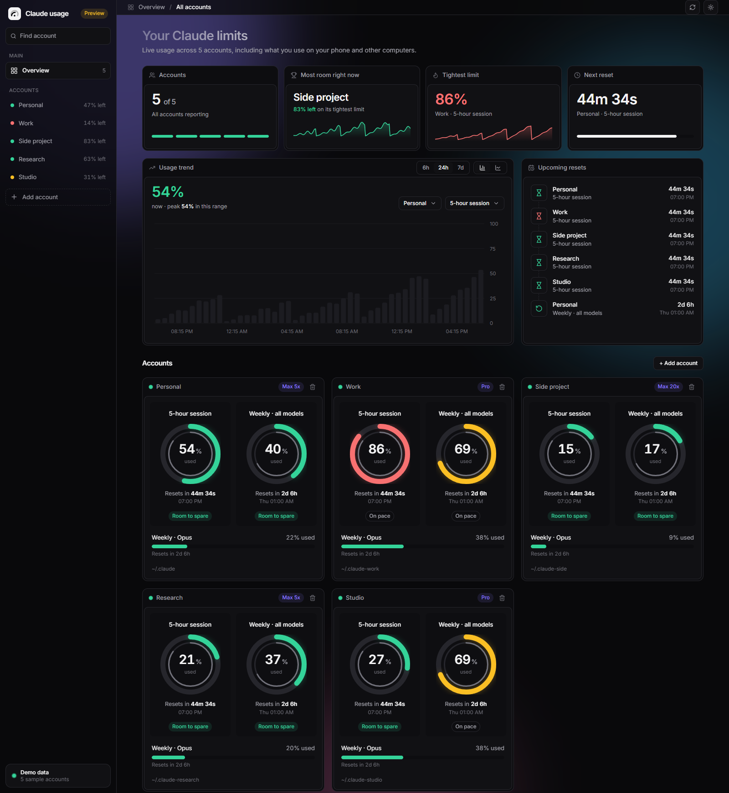

# Claude usage dashboard

Live usage limits for every Claude account you track: 5-hour and weekly limits, reset countdowns,
pace, history, and which account has the most room right now. Works on Windows, macOS and Linux.

Usage is tracked by Anthropic per account, so what you use on your phone or other computers
shows up here too.



Screenshot uses five sample accounts and generated usage data. No real account details are shown.

## Run it

You need [Node.js 18+](https://nodejs.org).

```bash
npm install
npm run dev
```

Your browser opens at <http://localhost:5173>. No accounts logged in yet? Preview it with fake data:

```bash
npm run dev:mock
```

### Run it as a single process (no dev server)

```bash
npm install
npm run build
npm start          # http://localhost:4777
```

## Run it in Docker

```bash
docker compose up -d --build
```

Open <http://localhost:4777>.

Edit `docker-compose.yml` to point at your accounts. Each folder mounted under `/accounts`
becomes one account, named after the folder:

```yaml
volumes:
  - ~/.claude:/accounts/personal:ro
  - ~/.claude-work:/accounts/work:ro
```

On Windows use paths like `C:/Users/you/.claude:/accounts/personal:ro`.

Docker limits:
- **macOS:** Claude Code keeps the login in the Keychain, which a container can't read. Use
  `npm run dev` / `npm start` on a Mac instead.
- **Linux:** the container runs as user 1000. If your login file is only readable by another user,
  add `user: "${UID}:${GID}"` to the service.

## Accounts

The dashboard finds `~/.claude` (Personal) and `~/.claude-work` (Work, if it exists) by itself.
Use **Add account** in the sidebar for others: give it a name and the account's Claude config folder
(its `CLAUDE_CONFIG_DIR`). Log in there once with Claude Code first. The list is saved in
`~/.claude-usage-dashboard.json`, and usage history in `~/.claude-usage-history.json`
(or in `DATA_DIR` if you set it).

On Windows, [scripts/claude-work.cmd](scripts/claude-work.cmd) launches Claude Desktop with a separate Work app profile. Double-clicking it no longer leaves an unused Claude Code console running. Copy it and [scripts/claude-work.vbs](scripts/claude-work.vbs) to your Desktop, then double-click the `.vbs` file for a fully hidden launcher console. Run `claude-work.cmd --cli` from a terminal when you want interactive Work Claude Code; other arguments pass through to the CLI. Sign in to Claude Code and Desktop Work profiles separately once.

## Share local Claude Code chats

Right-click Work account card, then choose **Share Personal CLI chats with Work**. Dashboard links Work's `projects` folder to Personal's local Claude Code transcripts. In Work Desktop Code, start a local session and type `/resume` to search and open a CLI chat.

For local Desktop chats, choose **Sync local Desktop chats both ways** in the same menu. On Windows, this copies missing Desktop session records between Personal and Work profiles. Reopen Desktop to refresh Recents. Existing records are never overwritten; repeat sync after creating new chats in either profile. The full conversation was verified to load in Work after copying a Personal record. Account logins stay separate. Avoid editing the same session concurrently in both profiles. Cloud chats, account-specific connectors, and Customize plugins do not move with local session records.

Crossing organizations can show a Claude Code notice about earlier thinking. [Anthropic binds some thinking blocks to the account that created them](https://platform.claude.com/docs/en/build-with-claude/preserved-thinking); another account cannot reuse those blocks. Visible chat history still loads, but Claude must reason again from that history. The dashboard cannot make account-bound private thinking transferable. Run `/compact` after switching if you want Claude to summarize the visible history into a shorter working context; this may use tokens and does not recover old thinking.

Choose **Copy local Code plugins and skills to Work** to copy missing locally installed plugins, their cache and marketplaces, and local skills from Personal. It preserves Work's existing plugin choices and never copies login files, hooks, permission settings, or account-managed skills. This copies about 300 MB on a typical configured machine. Claude Desktop Customize plugins and connectors sync through each Claude account separately and cannot be copied by this dashboard.

Desktop groups sessions by their recorded working folders. To see a flat list instead of many `scratch-*` groups, turn off **Group by project** in the controls above Recents.

This action needs dashboard running directly on same computer as Claude Code. It is unavailable in Docker demo mode and cannot link a read-only container mount.

## Settings (environment variables)

| Variable | Default | What it does |
| --- | --- | --- |
| `PORT` | `4777` | API / production server port |
| `HOST` | `127.0.0.1` | Interface to listen on |
| `MOCK` | off | `1` shows fake sample data |
| `DATA_DIR` | home folder | Where the account list and history are saved |
| `ALLOWED_HOSTS` | | Extra host names allowed, comma separated (to open it from another device) |
| `ALLOW_ANY_HOST` | off | `1` accepts any host name. Only on a network you trust |
| `NO_OPEN` | off | `1` stops it opening the browser on start |

To open it from your phone on the same Wi-Fi: `HOST=0.0.0.0 ALLOWED_HOSTS=<your-pc-ip> npm start`.
That lets anyone on your network see your usage percentages (never your logins).

## How it works, and what to know

- The server reads each account's login file locally and asks Anthropic for the usage numbers.
  Tokens never reach the browser.
- It uses an **unofficial, undocumented endpoint** (the one Claude Code's `/usage` uses). It can
  change or stop working without notice. If the format changes, the card shows the raw response.
- It never refreshes or changes a login. If a card says the login expired, open Claude Code with
  that account once.
- History starts when you first run the dashboard and grows while it is running. The latest
  successful usage reading is also saved in `~/.claude-usage-latest.json` (or `DATA_DIR`). If a
  later reading fails, the dashboard shows that saved reading with its timestamp until live usage
  works again.
  Existing history supplies a one-time fallback until the next successful live reading; its
  reset times are unavailable.
- Local chat-log cost estimates use [Anthropic's API prices](https://platform.claude.com/docs/en/about-claude/pricing),
  including model-specific prompt caching, Haiku 5.5 long prompts, and recorded fast mode,
  US inference, batch, and web search usage. Changing the price table rebuilds saved estimates
  from chat logs. Estimates are not subscription charges.
- The trend charts, rings and counters are animated. Animations switch off automatically if your
  system asks for reduced motion.
