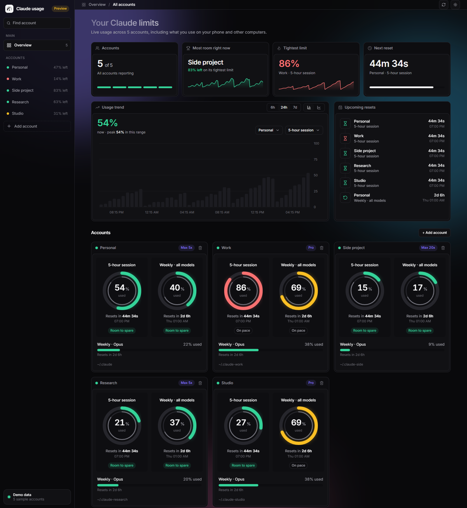

# Claude usage dashboard

Live usage limits for every Claude account you track: 5-hour and weekly limits, reset countdowns,
pace, history, and which account has the most room right now. Works on Windows, macOS and Linux.

Usage is tracked by Anthropic per account, so what you use on your phone or other computers
shows up here too.



Screenshot uses five sample accounts and generated usage data. No real account details are shown.

## Run it

You need [Node.js](https://nodejs.org) 20 or newer (the Docker image and CI use Node 22; see `.nvmrc`). `npm start` fails with a clear message on unsupported Node or when `dist/` is missing (run `npm run build` first).

```bash
npm install
npm run dev
```

Your browser opens at <http://localhost:5173>. No accounts logged in yet? Preview it with fake data:

```bash
npm run dev:mock
```

### Run it as a single process (no dev server)

```bash
npm install
npm run build
npm start          # http://localhost:4777
```

On Windows, run `powershell.exe -NoProfile -ExecutionPolicy Bypass -File scripts/install-windows.ps1` once after building. It adds a Dashboard Desktop shortcut and starts the background sync service at sign-in. The background launcher keeps the browser closed; open <http://localhost:4777> when needed. `scripts/open-dashboard.ps1` starts the service and opens the browser.

## Run it in Docker

```bash
docker compose up -d --build
```

Open <http://localhost:4777>.

Edit `docker-compose.yml` to point at your accounts. Each folder mounted under `/accounts`
becomes one account, named after the folder:

```yaml
volumes:
  - ~/.claude:/accounts/personal:ro
  - ~/.claude-work:/accounts/work:ro
```

On Windows use paths like `C:/Users/you/.claude:/accounts/personal:ro`.

Docker limits:
- **macOS:** Claude Code keeps the login in the Keychain, which a container can't read. Use
  `npm run dev` / `npm start` on a Mac instead.
- **Linux:** the container runs as user 1000. If your login file is only readable by another user,
  add `user: "${UID}:${GID}"` to the service.

## Accounts

The dashboard finds `~/.claude` (Personal) and `~/.claude-work` (Work, if it exists) by itself.
Use **Add account** in the sidebar for others: give it a name and the account's Claude config folder
(its `CLAUDE_CONFIG_DIR`). Log in there once with Claude Code first. The list is saved in
`~/.claude-usage-dashboard.json`, and usage history in `~/.claude-usage-history.json`
(or in `DATA_DIR` if you set it).

Max 5x and Max 20x cards omit the five-hour session window, including old cached readings. Other plans retain any five-hour window returned by their account's usage response.

On Windows, [scripts/claude-work.cmd](scripts/claude-work.cmd) launches Claude Desktop with a separate Work app profile. For a Desktop icon, create a shortcut to `powershell.exe -NoProfile -WindowStyle Hidden -ExecutionPolicy Bypass -File "<repo>\scripts\claude-work.ps1"` ([scripts/claude-work.ps1](scripts/claude-work.ps1)); leave launcher files in the repository so their relative paths work. Run `scripts/claude-work.cmd --cli` from a terminal when you want interactive Work Claude Code; other arguments pass through to the CLI. [scripts/claude-third.ps1](scripts/claude-third.ps1) opens an isolated Third profile; [scripts/claude-work2.ps1](scripts/claude-work2.ps1) opens Work2. Sign in to each account separately once. Profile launchers start background sync and copy available local chats, titles, and Personal's sidebar before opening an existing profile. After first sign-in, close and reopen that profile once so its new account scope can receive sidebar groups. Logins stay separate.

## Share local Claude Code chats

Right-click Work account card, then choose **Share Personal CLI chats with Work**. Dashboard links Work's `projects` folder to Personal's local Claude Code transcripts. In Work Desktop Code, start a local session and type `/resume` to search and open a CLI chat.

For local Desktop chats, choose **Sync local Desktop chats across profiles** in any non-Personal account menu. On Windows, dashboard checks every 10 seconds and copies new Desktop session records, including forked child records, among Personal, Work, and any additional isolated Desktop profiles found under `%LOCALAPPDATA%\ClaudeProfiles`. Set `DESKTOP_AUTO_SYNC=0` to disable this. When a profile fully closes, dashboard backs up and repairs stale records from newer continuations, then corrects stale branch metadata. Other profiles may stay open. Reopen closed profile to refresh existing chat panes; Claude Desktop does not reload modified local storage while open. Account logins stay separate. Avoid editing same session concurrently in multiple profiles. Cloud chats, account-specific connectors, and Customize plugins do not move with local session records.

On Windows, the dashboard reads Claude Desktop's local `main.log` cycle-health events to mark chats paused by a five-hour limit. It matches Desktop session IDs to Claude Code session IDs and clears the paused state after the reset or a healthy cycle. This depends on Claude's current log format; when that format changes, chat state falls back to the ordinary session status. Claude Code login data identifies a Team plan but does not disclose whether its seat is Standard or Premium. The dashboard shows `Team (seat unknown)` until you confirm Standard or Premium from the account menu. Confirm the tier with your organization admin; this label is only local dashboard metadata.

Chat titles and custom sidebar groups use separate Desktop profile settings. Dashboard uses Personal's group names, assignments, and saved order for other discovered profiles. It writes only profiles that have fully exited, including tray processes, and backs up their config and Local Storage. Reopen closed profiles to refresh sidebars. This uses undocumented Claude storage and may need an update when Claude changes its format. Group storage approach adapts [claude-desktop-session-sync](https://github.com/RasmusKD/claude-desktop-session-sync); see [third-party notices](THIRD_PARTY_NOTICES.md).

Remote Control belongs to the signed-in Claude Code account. To connect every new Work session automatically, set `remoteControlAtStartup` to `true` in `~/.claude-work/settings.json`. Personal and Work create separate remote sessions; switching accounts does not transfer an active Remote Control connection.

Crossing organizations can show a Claude Code notice about earlier thinking. [Anthropic binds some thinking blocks to the account that created them](https://platform.claude.com/docs/en/build-with-claude/preserved-thinking); another account cannot reuse those blocks. Visible chat history still loads, but Claude must reason again from that history. The dashboard cannot make account-bound private thinking transferable. Run `/compact` after switching if you want Claude to summarize the visible history into a shorter working context; this may use tokens and does not recover old thinking.

Choose **Copy local Code plugins and skills to Work** to copy missing locally installed plugins, their cache and marketplaces, and local skills from Personal. It preserves Work's existing plugin choices and never copies login files, hooks, permission settings, or account-managed skills. This copies about 300 MB on a typical configured machine. Claude Desktop Customize plugins and connectors sync through each Claude account separately and cannot be copied by this dashboard.

Desktop groups sessions by their recorded working folders. To see a flat list instead of many `scratch-*` groups, turn off **Group by project** in the controls above Recents.

This action needs dashboard running directly on same computer as Claude Code. It is unavailable in Docker demo mode and cannot link a read-only container mount.

## Settings (environment variables)

| Variable | Default | What it does |
| --- | --- | --- |
| `PORT` | `4777` | API / production server port |
| `HOST` | `127.0.0.1` | Interface to listen on |
| `MOCK` | off | `1` shows fake sample data |
| `DATA_DIR` | home folder | Where the account list, history, latest readings and token-scan cache (`.claude-usage-tokens.json`) are saved |
| `ACCOUNTS_DIR` | | Treat every sub-folder as one account (name = folder name). Used by Docker; also turns off desktop auto-sync |
| `API_PORT` | `4777` | Dev only: API port the Vite dev server proxies `/api` to. Set it when you change `PORT` for `npm run dev` |
| `TZ` | `UTC` | Docker only: time zone of the container (set in `docker-compose.yml`) |
| `ALLOWED_HOSTS` | | Extra host names allowed, comma separated (to open it from another device) |
| `ALLOW_ANY_HOST` | off | `1` accepts any host name. Only on a network you trust |
| `ACCOUNT_AUTO_SYNC` | on | `0` stops the 15-minute automatic account sync. It links every account's `projects` folder to the first account's (shared Claude Code chats) and copies missing skills, commands, agents, plugins and marketplaces between all accounts. It never overwrites or deletes. Run it on demand from an account's ⋮ menu → *Sync all accounts* |
| `DASHBOARD_NO_REFRESH` | off | `1` stops the dashboard renewing expired Claude Code logins. By default it uses the stored refresh token (like Claude Code does) and writes the new tokens back to that folder's `.credentials.json` |
| `DASHBOARD_TOKEN` | unset | Shared secret for mutating routes (add/delete account, sign-in, sync). Send as `X-Dashboard-Token` or `Authorization: Bearer`, or open `/?token=...` once to set a cookie. With `ALLOW_ANY_HOST=1` and no token, those routes return 403 |
| `DASHBOARD_SYNC_STATE_DIR` | `<DATA_DIR or home>/.claude-usage-sync` | Where sync baselines and state are kept |
| `NO_OPEN` | off | `1` stops it opening the browser on start |
| `DESKTOP_AUTO_SYNC` | on for direct Windows installs | `0` disables automatic copying of new local Desktop session records |

Security: the server checks the `Host` and `Origin` headers so other web pages cannot read your usage. `ALLOW_ANY_HOST=1` switches the Host check off, so only use it on a trusted network. In Docker keep the published port on loopback (`127.0.0.1:4777:4777`, as in `docker-compose.yml`). The image listens on `0.0.0.0` inside the container, so a bare `docker run -p 4777:4777` exposes it to your network.

To open it from your phone on the same Wi-Fi: `HOST=0.0.0.0 ALLOWED_HOSTS=<your-pc-ip> npm start`.
That lets anyone on your network see your usage percentages (never your logins).

## Testing

```bash
npm run typecheck   # tsc, covers src/ and vite.config.ts
npm run typecheck:server  # checkJs over server/*.js (non-blocking, reports existing type errors)
npm run lint        # eslint + react-hooks rules on src/
npm test            # node:test over server/*.test.js and src/lib/lib.test.mjs (runner: scripts/run-tests.mjs)
npm run test:coverage
```

GitHub Actions (`.github/workflows/ci.yml`) runs typecheck, lint and tests on pushes to `main` and on pull requests.
`classic-level` (native, Windows desktop label sync only) is an optional dependency; the server and Docker image run without it.
Windows launchers write logs to `data/` (`dashboard-watchdog.log`, `dashboard-server.log`, `launcher.log`). The watchdog honors `PORT`.

## How it works, and what to know

- The server reads each account's login file locally and asks Anthropic for the usage numbers.
  Tokens never reach the browser.
- It uses an **unofficial, undocumented endpoint** (the one Claude Code's `/usage` uses). It can
  change or stop working without notice. If the format changes, the card shows the raw response.
- It never refreshes or changes a login. If a card says the login expired, open Claude Code with
  that account once. On a direct Windows installation, choose **Sign in for usage** on its card to open Claude Code's sign-in for that account. Complete the sign-in in the new window; the dashboard checks again automatically. Desktop sign-in and Claude Code usage login are separate.
- History starts when you first run the dashboard and grows while it is running. The latest
  successful usage reading is also saved in `~/.claude-usage-latest.json` (or `DATA_DIR`). If a
  later reading fails, the dashboard shows that saved reading with its timestamp until live usage
  works again.
  Existing history supplies a one-time fallback until the next successful live reading; its
  reset times are unavailable.
- When a saved weekly limit is fully used, automatic usage requests pause until its next expected
  reset. A past weekly reset advances by seven-day periods; the next check time is saved across
  restarts so the dashboard checks when that reset arrives. Estimated times remain labeled until a
  fresh reading confirms them. Old five-hour resets cannot be inferred.
  Rate-limit responses use increasing retry delays, up to one hour. Manual refresh still respects
  Anthropic's retry delay.
- The usage trend offers **All accounts** and shows one recorded reading immediately. Accounts
  without readings in the selected range display that fact instead of an endless loading state.
- Local chat-log cost estimates use [Anthropic's API prices](https://platform.claude.com/docs/en/about-claude/pricing),
  including model-specific prompt caching, Haiku 5.5 long prompts, and recorded fast mode,
  US inference, batch, and web search usage. Changing the price table rebuilds saved estimates
  from chat logs. Estimates are not subscription charges.
- The trend charts, rings and counters are animated. Animations switch off automatically if your
  system asks for reduced motion.

API: `GET /api/health` returns `{ok, uptime, mock}` without contacting Anthropic (used by the Docker healthcheck and the watchdog). `ALLOWED_HOSTS` is case-insensitive and ignores ports. New accounts need an existing config folder.

Account menu (⋮): *Open Claude Code as …* starts a terminal with `CLAUDE_CONFIG_DIR` set to that account; *Open Claude Desktop as …* starts the matching Desktop profile (`~/.claude` is the normal app, `~/.claude-<name>` is the separate profile `<Name>`).

Codex (ChatGPT plan): add an account with the *Codex* service and a Codex folder (`~/.codex`, or `~/.codex-work` etc. for a second login: tick *create the folder*, then use the card's *Sign in* button, which runs `codex login` with that `CODEX_HOME`). Claude Code and Codex accounts can sit side by side; each card and sidebar entry carries an icon for its service. The dashboard reads the login Codex stores in `auth.json` and shows the 5-hour and weekly windows from ChatGPT's (undocumented) usage endpoint. Like Claude logins, an expired Codex access token is renewed from its refresh token (same call the Codex CLI makes) and written back to `auth.json`; `DASHBOARD_NO_REFRESH=1` turns that off for both. The card's *Chats* panel lists Codex threads active in the last 30 minutes (names from `session_index.jsonl`, state from the end of each rollout file; only the head and tail of those files are read). Codex accounts are left out of the chat, skill and plugin sync.
